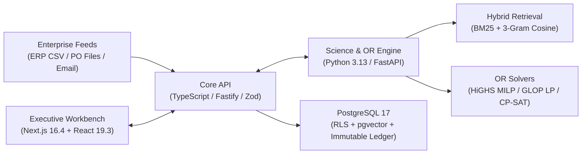

# ORVEXA — Enterprise Order & Operations Intelligence

> **Intelligence Behind Every Operation.**

ORVEXA is an enterprise B2B Order Intelligence and Mathematical Operations Research (OR) platform built for manufacturers, industrial suppliers, and large-scale distributors. It plugs directly into enterprise ERP catalogs, customer masters, and Purchase Order feeds (CSV, ERP exports, email/text POs), transforming fragmented inputs into mathematically validated, capacity-checked, human-approved operational records.

---

## Core Design Principles

- **Zero AI Hallucination:** Language/text pipelines only normalize and extract candidate spans with exact character provenance. SKUs are never invented.
- **100% Mathematical Operations Research:** Matching, multi-tier packaging, rule conflict diagnosis, risk calibration, review scheduling, factory capacity planning, and stock policies are solved deterministically using **Google OR-Tools (`HiGHS`, `GLOP`, `CP-SAT`)**.
- **Human-Only Approval Authority:** AI/OR prepares, validates, and optimizes; only authorized human roles (`Owner` / `Operations Manager`) can approve or reject Purchase Orders.
- **Strict Multi-Tenant Isolation:** PostgreSQL 17 Row-Level Security (`RLS`) enforces tenant boundaries at the database engine level, backed by an immutable append-only `activity_ledger`.

---

## System Architecture



Detailed mathematical formulations and state-machine diagrams are documented in [docs/02-technical-or-architecture.md](docs/02-technical-or-architecture.md).

---

## Mathematical Operations Research Suite

| Module | Mathematical Formulation | Solver Backend | Location |
|---|---|---|---|
| **Global PO Matching** | Constrained Bipartite Assignment (MILP) | `HiGHS` | [`global_matching.py`](services/science-engine/app/or_models/global_matching.py) |
| **Packaging & Units** | Integer Packaging & MOQ Decomposition (MILP) | `HiGHS` | [`packaging_solver.py`](services/science-engine/app/or_models/packaging_solver.py) |
| **Business Validation** | Constraint Satisfaction + Deletion MUS Core | `CP-SAT` | [`validation_mus.py`](services/science-engine/app/or_models/validation_mus.py) |
| **Risk Calibration** | Distribution-Free Split-Conformal Risk Control | Exact Quantile | [`conformal_calibration.py`](services/science-engine/app/or_models/conformal_calibration.py) |
| **Review Scheduling** | Parallel Machine SLA ($P_m \mid r_j \mid \sum w_j T_j + \lambda C_{\max}$) + Erlang-C | `CP-SAT` | [`review_scheduler.py`](services/science-engine/app/or_models/review_scheduler.py) |
| **Enterprise Diagnostics** | Capacity LP + Dual Shadow Prices + 4-Week CLSP MILP + $(s,S)$ / EOQ / ABC-XYZ | `GLOP` & `HiGHS` | [`enterprise_analyzer.py`](services/science-engine/app/or_models/enterprise_analyzer.py) |
| **Order Promising (CTP)** | Capable-to-Promise Stock & Overtime LP | `GLOP` | [`ctp_solver.py`](services/science-engine/app/or_models/ctp_solver.py) |

---

## Monorepo Structure

```text
orvexa/
├── .github/workflows/ci.yml        # Automated CI (pytest + Node tests + tsc + Next.js build)
├── apps/
│   ├── api/                        # TypeScript Fastify Core API, RBAC, Postgres RLS helper
│   └── web/                        # Next.js 16.4 + React 19.3 + Tailwind v4 Light Enterprise UI
├── services/
│   └── science-engine/             # Python 3.13 + FastAPI + OR-Tools (HiGHS / GLOP / CP-SAT)
├── packages/
│   └── db/                         # PostgreSQL 17 Multi-Tenant RLS Schema & Seed Data
├── infra/
│   └── docker-compose.yml          # pgvector/pg17 + Valkey
└── docs/
    ├── 01-business-master-spec.md  # Business & Product Master Specification v1.0
    ├── 02-technical-or-architecture.md
    └── 03-90-day-execution-plan.md
```

---

## Quickstart

### 1. Start Infrastructure (Optional for Full DB Persistence)
```bash
docker compose -f infra/docker-compose.yml up -d
```

### 2. Start Science & Operations Research Engine (`port 8001`)
```bash
cd services/science-engine
python3 -m venv .venv
.venv/bin/pip install -e .
.venv/bin/uvicorn app.main:app --port 8001 --reload
```

### 3. Install Workspace & Start Core API (`port 4000`)
```bash
npm install
npm run dev:api
```

### 4. Start Enterprise Workbench UI (`port 3000`)
```bash
npm run dev:web
```
Open `http://localhost:3000` to explore pre-configured enterprise profiles (**El Sewedy Electric** and **Mobica Furniture**) or onboard a new organization under **Company & ERP Connector**.

---

## Verification & Tests

```bash
# 1. Python Operations Research & AI test suite (10 mathematical & API tests)
cd services/science-engine && .venv/bin/pytest -v

# 2. Core API RBAC & multi-tenant isolation tests
npm run test:api

# 3. TypeScript strict check & Next.js production build
./node_modules/.bin/tsc -p apps/api/tsconfig.json --noEmit
npm run build:web
```
