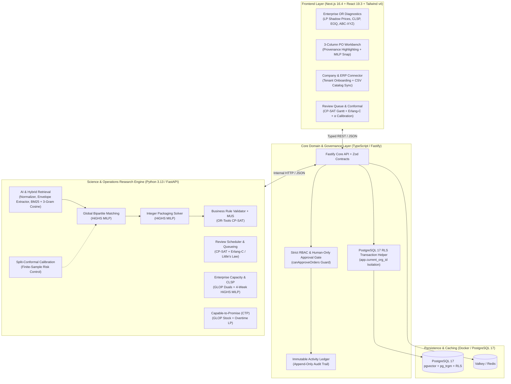
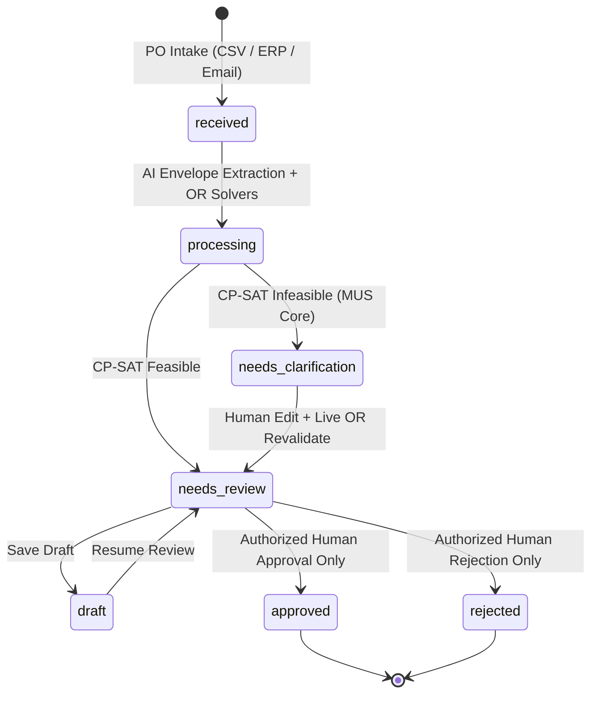

# ORVEXA — Technical, AI & Mathematical Operations Research Architecture

**Version:** 2.0  
**Aligned With:** ORVEXA Business & Product Master Specification v1.0 (Sections 1–28)

---

## 1. System Architecture Diagram

---

## 2. Core Architectural Principles

1. **Strict Separation of Truth States (Spec §6.6, §14.1, §14.15):**
   - `IncomingRequest` (immutable raw message/CSV/document + provenance offsets)
   - `CandidateOrder` (structured candidate extraction; never treated as business truth)
   - `ORAnalysisResult` (deterministic mathematical optimization & constraint verification)
   - `ApprovedOrder` (created **exclusively** by an authorized human actor via explicit action)
2. **Tenant Isolation at the Database Engine Level (Spec §8.1, §14.9):**
   - PostgreSQL Row-Level Security (`RLS`) enforces `organization_id = current_setting('app.current_org_id')::uuid` inside every transaction via `withTenantRlsTransaction`.
3. **Human-Only Final Authority (Spec §6.1, §14.5, §14.6):**
   - `apps/api` enforces `canApproveOrders` and blocks state transitions to `approved` or `rejected` unless initiated by an authorized human session with zero unresolved hard failures (or explicit override rationale).

---

## 3. Order Lifecycle State Machine

---

## 4. Mathematical Operations Research Models (100% Deterministic, Zero AI)

All optimization models execute inside `services/science-engine/app/or_models/` using **Google OR-Tools (`HiGHS`, `GLOP`, `CP-SAT`)**.

### 4.1 Global Constrained Bipartite Assignment (MILP) — `global_matching.py`
Solves order-wide SKU assignment across $M$ extracted lines ($i \in I$) and $N$ catalog SKUs ($j \in J$):
$$\min \sum_{i \in I} \sum_{j \in J} c_{ij} x_{ij} + \sum_{i \in I} P_{\text{unmatch}} u_i$$
subject to:
$$\sum_{j \in J} x_{ij} + u_i = 1 \;\; \forall i, \qquad \sum_{i \in I} x_{ij} \le 1 \;\; \forall j, \qquad x_{ij} \le A_{ij} \;\; \forall i, j$$
where $c_{ij}$ combines deterministic lexical/token Jaccard, character 3-gram cosine, BM25 tie-breaking, alias matching, and historical customer priors, while $A_{ij} \in \{0,1\}$ enforces strict unit compatibility.

### 4.2 Integer Packaging & Unit Decomposition (MILP) — `packaging_solver.py`
Resolves multi-tier industrial/wholesale packaging (`pallet`, `reel`, `drum`, `carton`, `box`, `unit`) subject to sealed-pack rules and $\text{MOQ}_j$:
$$\min \; \alpha^+ d_i^+ + \alpha^- d_i^- + \sum_{k \in K_j} \epsilon_k q_{ik}$$
$$\text{s.t.} \quad \sum_{k \in K_j} w_{jk} q_{ik} - d_i^+ + d_i^- = D_i, \qquad \sum_{k \in K_j} w_{jk} q_{ik} \ge \text{MOQ}_j, \qquad q_{ik} \in \mathbb{Z}_{\ge 0}$$

### 4.3 CP-SAT Business Rule Validator & Deletion MUS — `validation_mus.py`
Encodes hard business constraints as a CP-SAT feasibility problem. On infeasibility, extracts a **Minimal Unsatisfiable Subset (MUS)** identifying irreducible root conflicts and minimal repair actions.

### 4.4 Distribution-Free Split-Conformal Risk Control — `conformal_calibration.py`
Computes mismatch-cost threshold $\hat{\tau}$ from labeled historical corrections guaranteeing a finite-sample error upper bound $\alpha$ for items flagged as `clear_match`.

### 4.5 Parallel Machine SLA Scheduler & M/M/c Queueing — `review_scheduler.py`
Solves $P_m \mid r_j \mid \sum w_j T_j + \lambda C_{\max}$ via CP-SAT IntervalVars alongside **Erlang-C** and **Little's Law ($L = \lambda W$)** queue diagnostics.

### 4.6 Enterprise Diagnostics: Capacity LP Duals, 4-Week CLSP MILP & ABC-XYZ — `enterprise_analyzer.py`
- **Aggregate Capacity LP (GLOP Simplex):** Maximizes total contribution margin $\sum_j m_j x_j$ subject to plant resource hours $\sum_j a_{rj} x_j \le C_r$ and working-capital limits, extracting exact **Dual Shadow Prices ($\pi_r$)** per department and **+20% Bottleneck What-If** re-optimizations.
- **4-Week Capacitated Lot-Sizing Problem (CLSP MILP via HiGHS):** Optimizes weekly production $x_{jt}$, binary line setups $y_{jt} \in \{0,1\}$, and ending inventory $I_{jt}$ with flow conservation $I_{j,t-1} + x_{jt} - \text{sales}_{jt} = I_{jt}$.
- **Stochastic Inventory Policy:** Computes **Pareto ABC-XYZ**, Safety Stock $SS_j = z_j \sigma_j \sqrt{L_j}$, Reorder Point $s_j = \mu_j L_j + SS_j$, and EOQ $Q_j^* = \sqrt{2 K_j D_j / h_j}$.

### 4.7 Capable-to-Promise (CTP) Order Feasibility LP — `ctp_solver.py`
Evaluates any incoming PO against current stock and remaining plant capacity, prioritizing existing inventory first before computing required production and exact overtime hours per bottleneck resource.
